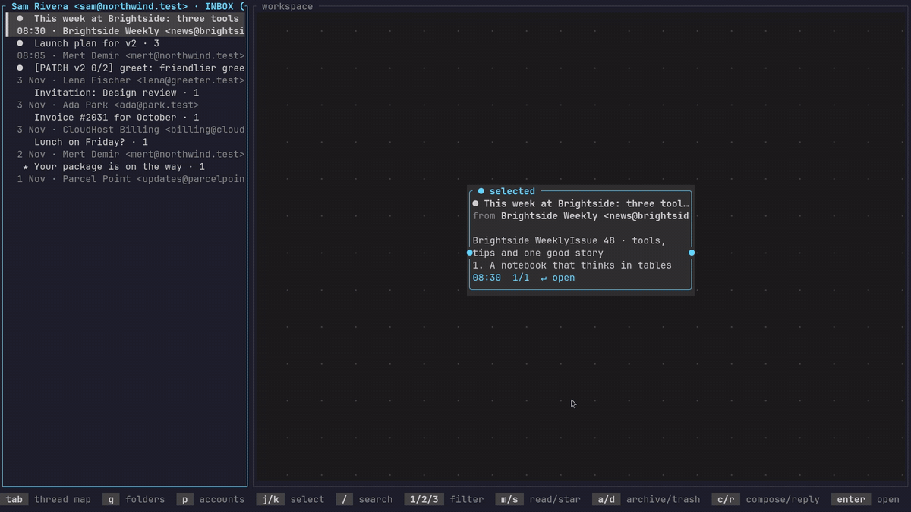

# termail

A fast, keyboard and mouse friendly mail client for the terminal.

termail keeps your mail in a local Maildir, syncs it with any IMAP server in the background and sends over SMTP. Next to the conversation list it draws each thread as a map, so you can see who answered whom at a glance.



## Install

**Linux and macOS**

```sh
curl -fsSL https://raw.githubusercontent.com/tuna4ll/termail/main/install.sh | sh
```

**Windows** (PowerShell)

```powershell
irm https://raw.githubusercontent.com/tuna4ll/termail/main/install.ps1 | iex
```

Both download the latest release for your system, check its checksum and put `termail` on your path: `~/.local/bin` on Linux and macOS, `%LOCALAPPDATA%\Programs\termail` on Windows. Set `TERMAIL_VERSION=v1.0.0` to install a specific release, or `TERMAIL_INSTALL_DIR` to choose the folder. Builds are available for Linux (x86_64, ARM64, glibc), macOS (Intel, Apple silicon) and Windows (x64), and are also attached to every [release](https://github.com/tuna4ll/termail/releases).

**From source**, with a recent Rust toolchain:

```sh
cargo install --git https://github.com/tuna4ll/termail
```

Optional: GnuPG for signing and encryption, and a terminal that can show pictures (kitty, Ghostty, WezTerm, foot or iTerm2) for images in HTML mail.

## Getting started

Run `termail`. The first time, it asks for your email address, finds your provider's servers and checks the account before saving anything. Passwords are kept in your system keyring, and OAuth2 sign-in is supported for providers that need it, such as Gmail and Outlook.

Want to look around first? Open the built-in sample mailbox:

```sh
termail --demo
```

## Everyday use

| Key | Action |
| --- | --- |
| `j` `k` or arrows | Move through the list |
| `enter` / `esc` | Open / close a message |
| `tab` | Switch between the list and the conversation map |
| `c` `r` `A` `F` | Write, reply, reply all, forward |
| `a` `d` | Archive, move to Trash |
| `m` `s` | Mark read or unread, star |
| `u` | Undo the last action |
| `/` | Search |
| `g` `p` | Folders, accounts |
| `:` | Run a command, such as `:sync` |
| `?` | Show every key |
| `q` | Quit |

The mouse works everywhere: click to select, double-click to open, right-click for a menu of actions, and scroll with the wheel. Drag the reader window by its title to move it, or by its corner to resize it.

**Writing.** Move between fields with `tab`. Press `enter` on the body to write it in your `$EDITOR`, or in the built-in editor. `ctrl+s` shows a summary to check before sending, and `ctrl+d` saves a draft. Drafts are also saved on their own while you type.

**Searching.** Type words to search everything, or narrow it down:

```
from:ada  subject:invoice  is:unread  has:attachment  after:7d  in:all
```

Press `ctrl+r` while searching to look on the server too, for older mail that is not downloaded yet.

## Configuration

Accounts you add in termail are saved to `~/.config/termail/config.toml`. Everything else is optional and takes effect as soon as you save the file:

```toml
[ui]
inbox_width = 40

[keys]
archive = "e"

[theme]
preset = "light"
```

[docs/configuration.md](docs/configuration.md) lists every setting, and [docs/scripting.md](docs/scripting.md) shows how to add your own keys, commands and rules in Lua. Run `termail doctor` to check your setup.

## Command line

```
termail                     start
termail --demo              open the sample mailbox
termail --config PATH       use another config file
termail doctor              check accounts, Maildir, editor and sending
termail oauth [ACCOUNT]     sign in with OAuth2 again
termail completions SHELL   print completions for bash, zsh or fish
termail man                 print the manual page
```

## Development

```sh
cargo test --locked
cargo clippy --locked --all-targets -- -D warnings
cargo fmt -- --check
```

To publish a release, set the version in `Cargo.toml`, commit, then push a matching tag such as `v1.0.0`. GitHub Actions builds every platform and attaches the binaries and checksums to the release.

## License

MIT
